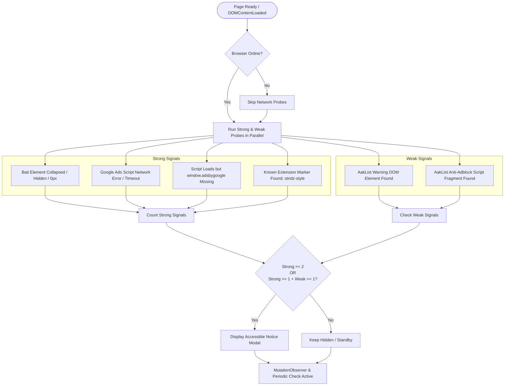

# khalequzzaman17/addetector

A production-quality, framework-agnostic Composer package that detects likely browser ad-blocking in Laravel and generic PHP applications using multi-signal client-side heuristics.

[](https://packagist.org/packages/khalequzzaman17/addetector)
[](https://www.php.net)
[](LICENSE)

---

## Important Limitation: The Reality of Browser-Side Detection

> [!IMPORTANT]
> **No browser-side ad-block detector can claim mathematically perfect 100% detection.**
> Because visitors control the browser execution environment:
> - Extensions can stub `window` globals or spoof network responses.
> - Content Security Policies (CSP) or network timeouts can resemble blocked requests.
> - Advanced filtering rules can hide anti-adblock modals after insertion.
>
> This package provides the **strongest practical, multi-signal probabilistic detection** with low false-positive rates by requiring corroborated signals before displaying notices.

---

## Features

- **Framework-Agnostic Core**: Pure PHP 8.1+ with zero external runtime dependencies.
- **Zero Client Dependencies**: Pure vanilla JavaScript with no jQuery, no third-party libraries, and no `eval()`.
- **Corroborated Multi-Signal Detection**:
  - **Strong Signals**: Bait element zero-size/collapse/hidden state, Google Ads script network error/timeout, missing `window.adsbygoogle` global, and known blocker DOM markers (`stndz-style`).
  - **Weak Signals**: Generic anti-adblock DOM selectors and script path fragments derived from Reek's AakList.
- **Low False Positives**:
  - Requires **2 strong signals** by default (or **1 strong + 1 weak signal**). Weak signals alone never trigger a notice.
  - Native offline check (`navigator.onLine`) prevents false positives during connectivity loss.
- **Observer-Safe**: MutationObserver integration dynamically monitors client changes while preventing recursion loops.
- **Accessible UI Modal**:
  - `role="dialog"`, `aria-modal="true"`, and `aria-labelledby`.
  - Full keyboard control: Escape key dismissal (when enabled) and focus trapping.
  - Configurable themes (light/dark), accent colors, scroll lock, reload button, and `<noscript>` fallback.
- **First-Class Laravel Integration**: Service provider, facade, configuration publishing, and `@adblockDetector` Blade directive.

---

## Installation

Install via Composer:

```bash
composer require khalequzzaman17/addetector
```

---

## Quick Start

### Generic PHP Applications

Render the detector snippet directly before the closing `</body>` tag:

```php
<?php

use AdblockDetector\AdblockDetector;
use AdblockDetector\DetectorConfig;
use AdblockDetector\NoticeConfig;

$detector = new AdblockDetector(
    new DetectorConfig(
        minimumStrongSignals: 2,
        periodicCheck: true,
        observeDomChanges: true,
    ),
    new NoticeConfig(
        title: 'Please disable your ad blocker',
        message: 'Disable your ad blocker and refresh the page.',
        closeText: 'Continue anyway',
        theme: 'light',
        primaryColor: '#2563eb',
    ),
);

// Output the CSS, dialog markup, and vanilla JS detector:
echo $detector->render();
```

---

### Laravel Integration

#### 1. Configuration Publishing (Optional)

In Laravel, the package automatically registers its Service Provider and Facade. You can publish the configuration file to customize defaults:

```bash
php artisan vendor:publish --tag=adblock-detector-config
```

This creates `config/adblock-detector.php`.

#### 2. Service Provider Singleton (Manual or Custom)

If you wish to configure the detector in a Service Provider (e.g. `AppServiceProvider.php`):

```php
namespace App\Providers;

use AdblockDetector\AdblockDetector;
use AdblockDetector\DetectorConfig;
use AdblockDetector\NoticeConfig;
use Illuminate\Support\ServiceProvider;

class AppServiceProvider extends ServiceProvider
{
    public function register(): void
    {
        $this->app->singleton(AdblockDetector::class, function () {
            return new AdblockDetector(
                new DetectorConfig(
                    minimumStrongSignals: 2,
                    periodicCheck: true,
                    observeDomChanges: true,
                ),
                new NoticeConfig(
                    title: 'Please disable your ad blocker',
                    message: 'Please support our website by whitelisting us in your ad blocker.',
                    closeText: 'Continue anyway',
                ),
            );
        });
    }
}
```

#### 3. Blade Layout Integration

Include the detector in your main layout (e.g. `resources/views/layouts/app.blade.php`) just before `</body>`:

Using the Blade directive:
```blade
    @adblockDetector
</body>
</html>
```

Or using the Facade / helper:
```blade
    {!! \AdblockDetector\Laravel\Facades\AdblockDetector::render() !!}
</body>
</html>
```

#### 4. View Composer / Middleware Option

If you only want the notice rendered for specific routes or guest users:

```php
namespace App\Http\Middleware;

use Closure;
use Illuminate\Http\Request;
use Illuminate\Support\Facades\View;
use AdblockDetector\AdblockDetector;

class AttachAdblockNotice
{
    public function handle(Request $request, Closure $next)
    {
        if (! $request->user()?->isSubscribed()) {
            View::share('adblockNoticeHtml', app(AdblockDetector::class)->render());
        }

        return $next($request);
    }
}
```

---

## Detection Architecture: How It Works

The detector evaluates the client environment using a multi-signal decision engine:



### Strong Signals
1. **Bait Element Sizing**: An off-screen element with ad classes (`adsbygoogle`, `ad-container`, `doubleclick`, `bannerad`, etc.) is injected. If its computed height or width is `0`, or `display: none` / `visibility: hidden` is applied by ad-blocker cosmetic stylesheets, it counts as a strong signal.
2. **Network Probe**: Asynchronously requests the Google Ads script with a bounded timeout (`requestTimeoutMs`). If the request is canceled (`onerror`), times out, or fails to define `window.adsbygoogle`, it counts as a strong signal (skipped if offline).
3. **Extension Markers**: Checks for DOM elements injected by specific blocker extensions (such as Fair AdBlocker's `stndz-style`).

### Weak Signals (AakList-Derived Heuristics)
1. **DOM Signatures**: Checks if elements matching known anti-adblock message containers exist (`#adblock-message`, `.deadblocker-header-bar`, `#adbuddy-overlay`, etc.).
2. **Script Patterns**: Checks if currently loaded `<script>` sources contain known anti-adblock signatures (`blockadblock`, `fuckadblock`, `anti-ad-buster.js`, etc.).

### Decision Threshold
- **Default Policy**: Displays notice if `strongSignals >= 2`, or `strongSignals >= 1 AND weakSignals >= 1`.
- **Safety Guarantee**: Weak signals **never** trigger detection on their own.

---

## Configuration Reference

### `DetectorConfig` Options

| Option | Type | Default | Description |
| :--- | :--- | :--- | :--- |
| `enabled` | `bool` | `true` | Master switch to enable or disable detection. |
| `minimumStrongSignals` | `int` | `2` | Number of strong signals needed when no weak signal is present (1–3). |
| `allowWeakSignalAssistance` | `bool` | `true` | When true, 1 strong + 1 weak signal can trigger notice. |
| `periodicCheck` | `bool` | `false` | Whether to periodically re-evaluate signals. |
| `periodicIntervalMs` | `int` | `30000` | Periodic check frequency in ms (min: 1000). |
| `requestTimeoutMs` | `int` | `4000` | Network probe timeout in ms (min: 250). |
| `observeDomChanges` | `bool` | `true` | Use `MutationObserver` to catch dynamically injected DOM elements. |
| `checkOnDomReady` | `bool` | `true` | Wait for `DOMContentLoaded` before executing detection. |
| `checkGoogleAds` | `bool` | `true` | Probe network script loading against Google Ads endpoint. |
| `googleAdsUrl` | `string` | `'https://pagead2.googlesyndication.com/pagead/js/adsbygoogle.js'` | URL for network probe. |
| `checkBaitElement` | `bool` | `true` | Inject ad-like bait element to detect cosmetic filtering. |
| `checkKnownMarker` | `bool` | `true` | Check for known extension DOM markers. |
| `sensitivity` | `string` | `'balanced'` | Preset: `'strict'`, `'balanced'`, `'lenient'`, or `'custom'`. |
| `knownMarkers` | `array` | `['stndz-style']` | Custom extension DOM markers. |
| `antiAdblockSelectors` | `array` | `AakListProfile::selectors()` | Custom selectors for weak DOM signal. |
| `antiAdblockScriptPatterns`| `array` | `AakListProfile::scriptPatterns()` | Custom script path patterns for weak script signal. |
| `baitClasses` | `array` | `AakListProfile::baitClasses()` | Custom CSS classes for bait element. |

#### Sensitivity Presets:
```php
// Strict: Triggers on 1 strong signal, or 1 strong + 1 weak signal
$config = DetectorConfig::strict();

// Balanced (default): Triggers on 2 strong signals, or 1 strong + 1 weak signal
$config = DetectorConfig::balanced();

// Lenient: Requires 2 strong signals and ignores weak signals entirely
$config = DetectorConfig::lenient();
```

---

### `NoticeConfig` Options

| Option | Type | Default | Description |
| :--- | :--- | :--- | :--- |
| `title` | `string` | `'Please disable your ad blocker'` | Modal dialog header title. |
| `message` | `string` | `'Please disable your ad blocker...'` | Notice explanation body. |
| `refreshText` | `string` | `'Refresh'` | Label for the reload/refresh button. |
| `closeText` | `?string`| `null` | Label for dismissal button (`null` hides the close button). |
| `theme` | `string` | `'light'` | `'light'` or `'dark'`. |
| `primaryColor` | `string` | `'#2563eb'` | Accent color hex/rgb for buttons and focus rings. |
| `lockPage` | `bool` | `true` | Prevent page scrolling while notice is visible. |
| `showNoscriptFallback` | `bool` | `true` | Render fallback warning when JavaScript is disabled. |
| `iconUrl` | `string` | `''` | Optional image/icon URL displayed in notice. |
| `customCss` | `string` | `''` | Custom CSS injected alongside modal styles. |

---

## Security & Content Security Policy (CSP)

- **HTML Escaping**: User-controlled inputs (`title`, `closeText`, `refreshText`, `iconUrl`) are strictly escaped with `htmlspecialchars(..., ENT_QUOTES | ENT_SUBSTITUTE, 'UTF-8')`. Message bodies allow only safe inline formatting tags (`<strong>`, `<em>`, `<a>`, `<p>`, `<br>`).
- **Safe JSON Serialization**: Configuration data passed to JavaScript is encoded with `JSON_HEX_TAG | JSON_HEX_AMP | JSON_HEX_APOS | JSON_HEX_QUOT`.
- **No `eval()`**: The client code contains zero runtime evaluation or string obfuscation.
- **Content Security Policy (CSP)**:
  If your application utilizes a strict `script-src` Content Security Policy, you should allow:
  - Script probe endpoint: `https://pagead2.googlesyndication.com` in `script-src` (or disable the Google Ads network probe with `checkGoogleAds: false`).
  - Use a CSP nonce for inline scripts if inline scripts are restricted.

---

## Attribution & License

### AakList Attribution
The secondary heuristic selectors and script patterns used in `AdblockDetector\AakListProfile` were derived from [Anti-Adblock Killer filters](https://raw.githubusercontent.com/reek/anti-adblock-killer/master/anti-adblock-killer-filters.txt):
- **Author**: Reek
- **License**: Creative Commons Attribution-ShareAlike 4.0 International ([CC BY-SA 4.0](https://creativecommons.org/licenses/by-sa/4.0/))
- **Source**: `https://raw.githubusercontent.com/reek/anti-adblock-killer/`

### Package License
This package is licensed under the [MIT License](LICENSE).
